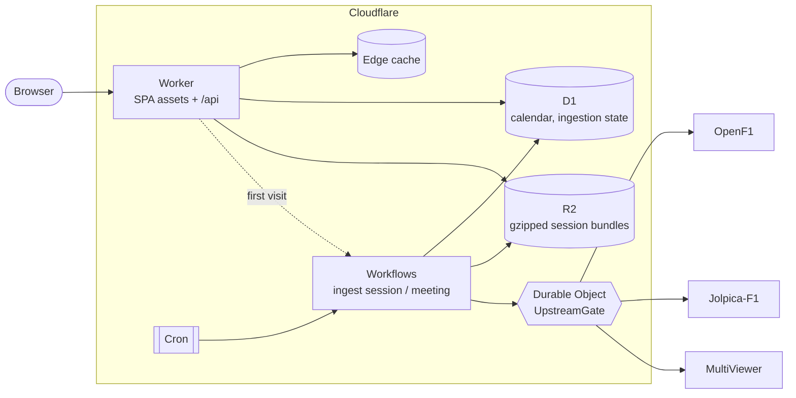

# F1 RaceView

**[f1raceview.com](https://f1raceview.com)** is a Formula 1 analysis site covering every session since 2023. It runs entirely on Cloudflare.

- **Results**: the official classification, grid and penalties, and the championship standings
- **Laps**: lap times, ideal laps from the best sectors, top speeds, and long-run pace
- **Race**: positions lap by lap, the gap to the leader, and overtakes
- **Strategy**: tyre stints, pit stop times, and tyre degradation
- **Telemetry**: speed, throttle, brake and gear compared driver against driver, a running delta, and a mini-sector dominance map
- **Replay**: the whole race replayed on the track map
- **Race control**: flags, the safety car, stewards' decisions, and the weather

The interface is in French and English.

## How it works

A single Cloudflare Worker serves both the single-page app (as static assets) and a small [Hono](https://hono.dev) API under `/api`. Visitors never reach the upstream data providers. Every session is ingested once in the background, stored in D1 and R2, and then served from there.



### Ingestion

- **Scheduling.** A cron runs every 10 minutes. It syncs the calendar and queues each session about 40 minutes after the chequered flag. A second pass the next day picks up the stewards' decisions. A nightly run backfills older seasons a few weekends at a time and refreshes the standings.
- **Workflows.** Ingestion runs as [Cloudflare Workflows](https://developers.cloudflare.com/workflows/) made of small steps that can be retried. If a request fails, only that step runs again. Telemetry is fetched in 10-minute windows of car data so each step fits in Worker memory.
- **Rate limiting.** Every upstream request, from any isolate or workflow, goes through `UpstreamGate`, a Durable Object with one instance per provider. The gate:
  - keeps requests under each provider's limit (about 3 req/s for OpenF1)
  - merges identical requests that are in flight at the same time
  - backs off on 429 and 5xx responses
  - has two priority lanes, so a session a visitor is waiting for jumps ahead of the backfill
- **Cross-checking sources.** OpenF1 provides the raw timing data. It is checked against Jolpica's official classification for the grid, retirement status and points. If OpenF1 has no result yet, the classification comes entirely from Jolpica.

### Serving

- **Immutable bundles.** Each session is stored in R2 as a gzipped bundle, with the telemetry for each driver and the replay data stored separately. The Worker sends the stored bytes unchanged (`encodeBody: 'manual'`), at URLs versioned by a content hash, with `Cache-Control: immutable`. If the content changes, the hash changes.
- **Compact telemetry.** Every channel is a series of integers, encoded as differences from the previous value, then gzipped. The result is about 45% smaller than plain JSON.
- **Edge caching.** Responses built from D1 are cached at the edge with ETags. The cache time is short during a race weekend and longer the rest of the time.
- **Frontend.** React 19, TanStack Router and Query, and Tailwind v4. The app is split into chunks by route and by tab, and a page's data is preloaded when you hover a link to it. All charts are hand-written SVG and canvas, with no chart library.

### Repository layout

```
shared/          API contract (types), session helpers, telemetry codec. Used by both the worker and the app
worker/
  index.ts       Hono routes, cron entry point
  upstream/      UpstreamGate (Durable Object) and typed OpenF1 / Jolpica / MultiViewer clients
  ingest/        workflows, scheduler, and the pure transforms (bundle.ts, telemetry.ts)
  lib/           D1 queries, R2 storage, HTTP caching helpers
src/             React app: routes, features (session tabs, telemetry, replay), charts, i18n
migrations/      D1 schema
test/            vitest suite, run on real data from the 2026 Singapore GP
```

## Running locally

Requires Node 24.

```bash
npm install
cp .dev.vars.example .dev.vars   # sets ADMIN_TOKEN for the /api/admin endpoints
npm run db:migrate:local
npm run dev                      # http://localhost:5173. Runs the Worker, D1, R2, Durable Objects and Workflows locally
```

The local database starts empty. To seed it, sync a season's calendar, then open any finished session. The first visit starts its ingestion.

```bash
curl -X POST -H "Authorization: Bearer dev-admin-token" localhost:5173/api/admin/sync/2026
```

Other scripts:

| Command | |
|---|---|
| `npm test` | Runs the tests on real session data |
| `npm run typecheck` | Type-checks the app and the worker (run `npm run cf-typegen` first if you edit `wrangler.jsonc`) |
| `npm run build` | Builds the production bundle |

## API

All endpoints are public and read-only, except the admin ones.

| Endpoint | Caching |
|---|---|
| `GET /api/home` | 30 s during a race weekend, 5 min otherwise |
| `GET /api/seasons/:year`, `GET /api/meetings/:key` | Same as `/api/home` |
| `GET /api/sessions/:key` | Short. Returns versioned URLs to the session's data |
| `GET /api/sessions/:key/bundle?v=` | Immutable |
| `GET /api/sessions/:key/telemetry/:driver?v=` | Immutable |
| `GET /api/sessions/:key/replay?v=` | Immutable |
| `GET /api/circuits/:circuit/:year` | 1 day |
| `GET /api/standings/:year` | 5 min (current season) |
| `POST /api/admin/{sync/:year, ingest/:key, standings/:year, tick}`, `GET /api/admin/status` | `Bearer ADMIN_TOKEN` |

## Deployment

On every push to `main`, [CI](.github/workflows/ci.yml) runs these steps:

1. Type-check
2. Run the tests
3. Build
4. Apply the D1 migrations
5. Deploy the Worker

Pull requests from this repository get a preview Worker on `workers.dev` that reads the production data. Previews have no cron and no admin endpoints. The preview URL is shown in the CI job summary.

To run your own instance, set these GitHub secrets: `CLOUDFLARE_API_TOKEN` (with access to Workers, D1, R2 and Workflows), `CLOUDFLARE_ACCOUNT_ID` and `ADMIN_TOKEN`. Also change the D1 database ID and the domains in `wrangler.jsonc`.

<details>
<summary>Backfill helper</summary>

OpenF1 throttles requests by IP address, so you can speed up the telemetry backfill by also running it from your own machine. `npm run backfill:local` starts the Worker locally (the `backfill` environment in `wrangler.jsonc`). It uses the production D1 and R2, but its own rate limiter and workflows. It only takes telemetry jobs. Jobs are claimed in D1 the same way production claims them, so the two never run the same job. If a job is interrupted, either side picks it up again after 2 hours. The helper needs `wrangler login` and the `ADMIN_TOKEN` from `.dev.vars`.

</details>

## Data sources

- [OpenF1](https://openf1.org): timing, laps, tyres, positions, car telemetry, race control
- [Jolpica-F1](https://github.com/jolpica/jolpica-f1): official classifications and championship standings
- [MultiViewer](https://multiviewer.app): circuit layouts

Thanks to these projects for making the data available.

## License

[MIT](LICENSE).

F1 RaceView is an unofficial project. It is not associated with Formula 1 or Formula One Management. F1, FORMULA ONE and related marks are trademarks of Formula One Licensing B.V.
